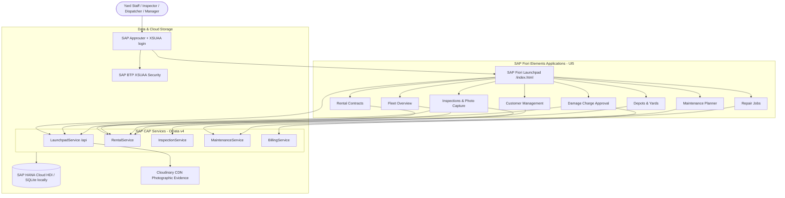

# 🚜 RETS - Rental Equipment Tracking System

[](https://cap.cloud.sap)
[](https://www.sap.com/products/technology-platform/hana.html)
[](https://experience.sap.com/fiori/)
[](https://cloudinary.com)
[](https://nodejs.org/)

An enterprise-grade **Rental Equipment Tracking and Lifecycle Management System** built on **SAP Cloud Application Programming Model (CAP)**, **SAP HANA Cloud**, and **SAP Fiori**. Designed for heavy machinery yards, equipment depots, and construction rental operations to streamline rental dispatch, automated check-in inspections, workshop repairs, and photographic damage billing.

---

## 📑 Table of Contents

- [Overview & Architecture](#-overview--architecture)
- [Key Features & Modules](#-key-features--modules)
- [Enterprise Tech Stack](#-enterprise-tech-stack)
- [Fiori Applications](#-fiori-applications)
- [OData Services & APIs](#-odata-services--apis)
- [Project Directory Structure](#-project-directory-structure)
- [Getting Started](#-getting-started)
- [Automated Tests](#-automated-tests)
- [Photographic Evidence Integration (Cloudinary)](#-photographic-evidence-integration-cloudinary)
- [SAP BTP Deployment (MTA)](#-sap-btp-deployment-mta)
- [Security & Role-Based Access (RBAC)](#-security--role-based-access-rbac)
- [Business Rules](#-business-rules)

---

## 🏗 Overview & Architecture

RETS unifies yard logistics, customer rentals, equipment maintenance, and financial billing into a single platform:



---

## ✨ Key Features & Modules

- **Fleet & Asset Tracking**: Operational status (`Available`, `RentedOut`, `ReturnedPendingInspection`, `Damaged`, `InRepair`, `Quarantined`, ...) with condition grade, meter hours, depot and a full status history.
- **Rental Contract Lifecycle**: Contract numbers (`RENT-10002`, ...), equipment allocation with double-booking protection, check-in, cancellation and status history.
- **Digital Yard Inspections**: Check-Out (dispatch) and Check-In (return) condition logs with grades A-D, enforced Check-Out → Check-In sequence per contract, immutable (locked) reports.
- **Photographic Damage Evidence (FR-009)**: Live camera or file upload, SHA-256 fingerprint computed in the browser and verified by the server, stored on Cloudinary CDN.
- **Workshop Maintenance & Repairs**: Preventive maintenance schedules, repair jobs from damage records, automatic release of the asset back into the fleet.
- **Damage Billing & Approval**: Pricing-rule based charge calculation, adjust / approve / reject / dispute workflow, invoice posting with an S/4HANA outbox message.

---

## 💻 Enterprise Tech Stack

| Layer | Technology | Details |
| :--- | :--- | :--- |
| **Backend Framework** | SAP CAP (`@sap/cds` v10) | Node.js services with OData v4, Fiori draft handling |
| **Persistence Layer** | SAP HANA Cloud / `@cap-js/hana` | HDI container on BTP, SQLite (`@cap-js/sqlite`) for local development and tests |
| **Frontend UI** | SAP Fiori Elements (SAPUI5 1.153) | List Report / Object Page apps in a Fiori launchpad (sandbox) |
| **Media / CDN** | Cloudinary SDK (`cloudinary` v2) | Image storage for damage proof |
| **Security & Auth** | SAP BTP XSUAA (`@sap/xssec` v4) | OAuth 2.0 / JWT, role-based access on services and actions |
| **Packaging** | Cloud Foundry MTA (`mta.yaml`) | Approuter, CAP server, HDI deployer |
| **Tests** | `@cap-js/cds-test` + `node:test` | 30 API tests for roles, lifecycle and billing (`npm test`) |

---

## 📱 Fiori Applications

The launchpad (`app/index.html`) shows only the tiles that the logged-in user's roles grant access to, each with a live KPI number.

| App Path | Module Name | Service | Roles |
| :--- | :--- | :--- | :--- |
| [`app/fleet-overview`](app/fleet-overview) | **Fleet Overview** | RentalService | Admin, Dispatcher, YardWorker, Manager, Auditor |
| [`app/rentals`](app/rentals) | **Rental Contracts** | RentalService | Admin, Dispatcher, Manager, Auditor |
| [`app/customer-management`](app/customer-management) | **Customer Management** | RentalService | Admin, Dispatcher, Manager |
| [`app/locations`](app/locations) | **Depots & Yards** | RentalService | Admin, Dispatcher, YardWorker, Manager, Auditor |
| [`app/inspections`](app/inspections) | **Inspections** | InspectionService | Admin, Dispatcher, YardWorker, Manager, Auditor |
| [`app/damage-charge-approval`](app/damage-charge-approval) | **Damage Charge Approval** | BillingService | Admin, BillingClerk, Manager, Auditor, YardWorker, Technician |
| [`app/repair-jobs`](app/repair-jobs) | **Workshop Repair Jobs** | MaintenanceService | Admin, Technician, Manager |
| [`app/maintenance-planner`](app/maintenance-planner) | **Maintenance Planner** | MaintenanceService | Admin, Technician, Manager |

Every app is a standalone UI5 component (`webapp/Component.js`, `manifest.json`, `index.html`) and can also be opened directly, e.g. `http://localhost:4004/rentals/webapp/index.html`.

---

## 🔌 OData Services & APIs

- **`RentalService`** (`/rental`): equipment, customers, contracts and items, depots; actions `checkOutRental`, `checkInRental`, `cancelRental`, `transferEquipment`, `Locations.assignEquipment`.
- **`InspectionService`** (`/inspection`): condition logs, damage records, photos; actions `submitInspection`, `lockInspection`, `acknowledgeInspection`.
- **`MaintenanceService`** (`/maintenance`): maintenance records, repair jobs; actions `createRepairJob`, `completeRepairJob`, `completeMaintenanceRecord`, `releaseEquipmentToAvailable`.
- **`BillingService`** (`/billing`): repair bills, pricing rules, S/4HANA outbox; actions `calculateDamageCharge`, `adjustRepairBill`, `approveRepairBill`, `rejectRepairBill`, `disputeRepairBill`, `postInvoice`.
- **`LaunchpadService`** (`/api`): `whoAmI()` and `kpis()` for the launchpad, `uploadEvidence` for the photo capture dialog, `cloudinaryStatus()`.

---

## 📂 Project Directory Structure

```text
sprint/
├── app/                              # SAP Fiori frontend
│   ├── index.html                    # Fiori launchpad (sandbox), tiles by user role
│   ├── common/evidence-capture.js    # Photo capture dialog (camera / upload, SHA-256)
│   ├── customer-management/          # Customer Directory
│   ├── damage-charge-approval/       # Damage Billing & Approval (+ Capture Photo action)
│   ├── fleet-overview/               # Fleet & Equipment Health
│   ├── inspections/                  # Yard Inspections (+ Capture Photo action)
│   ├── locations/                    # Depots & Yards
│   ├── maintenance-planner/          # Maintenance Scheduling
│   ├── rentals/                      # Rental Contracts & Allocations
│   └── repair-jobs/                  # Workshop Work Orders
├── db/
│   ├── schema.cds                    # Domain model
│   └── data/                         # Demo data (CSV), loaded locally and deployed to HDI
├── srv/
│   ├── billing-service/              # Pricing engine & approval workflow
│   ├── inspection-service/           # Inspection lifecycle
│   ├── maintenance-service/          # Repair jobs & maintenance
│   ├── rental-service/               # Contracts, allocation, transfers
│   ├── launchpad-service/            # whoAmI, KPIs, photo evidence upload
│   ├── common/                       # Cloudinary client, draft clean-up
│   └── index.cds                     # Service index
├── test/rets.test.js                 # API tests (npm test)
├── .deploy/app-router/               # SAP Approuter (XSUAA login, CSRF)
├── mta.yaml                          # Multi-Target Application descriptor
├── xs-security.json                  # XSUAA scopes & role templates
└── package.json                      # Dependencies, CAP profiles, mocked users
```

---

## 🚀 Getting Started

### Prerequisites

- **Node.js** 22 or newer
- **SAP CDS DK**: `npm i -g @sap/cds-dk` (or use `npx cds`)
- **Cloud Foundry CLI** and **MBT** (only for SAP BTP deployments)

### Installation & Local Run

```bash
npm install
npm run watch          # = cds watch (profile "development": in-memory SQLite + mocked users)
```

Open the launchpad at [http://localhost:4004/index.html](http://localhost:4004/index.html) and log in with one of the mocked users (user name = password):

| User | Role |
| :--- | :--- |
| `admin` | Admin |
| `manager` | Manager |
| `dispatcher` | Dispatcher |
| `inspector` | YardWorker |
| `technician` | Technician |
| `billing` | BillingClerk |
| `auditor` | Auditor |

The demo data in `db/data/*.csv` (XYZ Construction / CAT 320 scenario: customers, depots, equipment, contracts, inspections, damages, repair bill, pricing rules) is loaded automatically.

### Environment Configuration (optional)

Create a local `.env` file based on [`.env.example`](.env.example) to upload photos to Cloudinary:

```ini
CLOUDINARY_URL=cloudinary://<api_key>:<api_secret>@<cloud_name>
```

> [!IMPORTANT]
> The `.env` file is ignored by Git. Without Cloudinary credentials, photos are stored as SHA-256 sealed data URIs in the database.

---

## 🧪 Automated Tests

```bash
npm test
```

The tests run against an in-memory SQLite database with the demo data and cover login and roles, the rental contract lifecycle, check-out / check-in inspections, locking, photo evidence (including drafts), damage billing and workshop repairs.

---

## 📸 Photographic Evidence Integration (Cloudinary)

During yard inspections and damage billing, the **Capture Photo** action of the photo table opens the capture dialog:

- **Capture**: live camera (WebRTC) or image file from the device, with GPS position when the browser allows it.
- **Integrity**: the browser computes the SHA-256 hash; `LaunchpadService.uploadEvidence` recomputes it from the uploaded bytes and the dialog rejects a mismatch.
- **Storage**: the image goes to Cloudinary (`srv/common/cloudinary.js`); the `DamagePhotos` row stores URL, public ID, hash, GPS, uploader and time.
- **Drafts**: while the inspection or bill is being edited, the photo is added to the draft and activated together with it.
- **Immutability**: photo rows cannot be edited, and photos cannot be added to a locked inspection.

---

## ☁ SAP BTP Deployment (MTA)

1. **Cloudinary credentials** (optional, once per space):
   ```bash
   cf cups sprint-cloudinary -p '{"CLOUDINARY_URL":"cloudinary://<api_key>:<api_secret>@<cloud_name>"}'
   ```
   Without this service, remove the `sprint-cloudinary` entries from `mta.yaml`.
2. **Build the MTA archive**:
   ```bash
   mbt build
   ```
3. **Deploy to the SAP BTP space**:
   ```bash
   cf deploy mta_archives/sprint_1.0.0.mtar
   ```
4. **Assign role collections** (BTP cockpit → Security → Role Collections), e.g. `Dispatcher (sprint <org>-<space>)`, to the users.

The MTA builds and deploys:

- **`sprint`**: approuter with XSUAA login and CSRF protection (`.deploy/app-router`).
- **`sprint-srv`**: CAP Node.js server, also serving the Fiori apps and the launchpad (`gen/srv/app`).
- **`sprint-db-deployer`**: HDI deployer for tables, views and demo data in the `RETS` HDI container.
- **`sprint-auth`**: XSUAA instance with the role collections of `mta.yaml`.

---

## 🔐 Security & Role-Based Access (RBAC)

Roles are defined in [`xs-security.json`](xs-security.json) and enforced by CAP (`@requires` / `@restrict` on services, entities **and actions**):

| Role | Description |
| :--- | :--- |
| `Dispatcher` | Customers, depots, equipment master, rental contracts, check-out / cancel / transfer |
| `YardWorker` | Inspections, damage records, photo evidence, check-in |
| `Technician` | Repair jobs, maintenance records, release of repaired equipment |
| `BillingClerk` | Calculate, adjust, dispute and post repair bills |
| `Manager` | All operations incl. approving / rejecting bills and locking inspections |
| `Admin` | Full access |
| `Auditor` | Read-only access to all records and the S/4HANA outbox |

---

## 📋 Business Rules

- **Allocation**: equipment can only be allocated when it is `Available`, has no open repair job and is not booked or selected in another contract.
- **Contracts**: saving a new contract activates it and rents its equipment out; changing an existing contract only validates newly added equipment. Returned, closed and cancelled contracts are read-only.
- **Inspections**: the inspection type is suggested from the contract history (Check-Out, then Check-In) and validated on save. Status changes are applied once, when the inspection is created. A contract becomes `Returned` when its last equipment is checked in.
- **Bill workflow**: `Draft/PendingApproval → Adjusted → Approved → Posted`, with `Rejected` and `Disputed` branches; posted and rejected bills cannot be edited.
- **Repairs**: completing a repair job marks the damage `Repaired` and releases the asset to `Available` (grade B) unless another repair job on it is still open.

---

## 📄 License & Maintainer

Maintained for the **SAP Sprint Project**, originally by **VasuPMen** and Dipeswar Pal.
Built with ❤️ using the SAP Cloud Application Programming Model.
