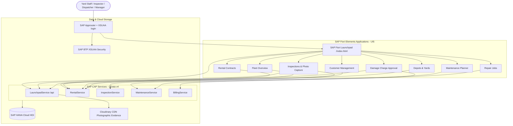

# 🚜 RETS - Rental Equipment Tracking System

[](https://cap.cloud.sap)
[](https://www.sap.com/products/technology-platform/hana.html)
[](https://experience.sap.com/fiori/)
[](https://cloudinary.com)
[](https://nodejs.org/)

An enterprise-grade **Rental Equipment Tracking and Lifecycle Management System** built on **SAP Cloud Application Programming Model (CAP)**, **SAP HANA Cloud**, and **SAP Fiori**. Designed for heavy machinery yards, equipment depots, and construction rental operations to streamline rental dispatch, automated check-in inspections, workshop repairs, and photographic damage billing.

---

## 📑 Table of Contents

- [Deployment to SAP BTP](#-deployment-to-sap-btp-cloud-foundry)
- [Overview & Architecture](#-overview--architecture)
- [Key Features & Modules](#-key-features--modules)
- [Enterprise Tech Stack](#-enterprise-tech-stack)
- [Fiori Applications](#-fiori-applications)
- [OData Services & APIs](#-odata-services--apis)
- [Project Directory Structure](#-project-directory-structure)
- [Automated Tests](#-automated-tests)
- [Photographic Evidence Integration (Cloudinary)](#-photographic-evidence-integration-cloudinary)
- [Security & Role-Based Access (RBAC)](#-security--role-based-access-rbac)
- [Business Rules](#-business-rules)

---

## 🚀 Deployment to SAP BTP (Cloud Foundry)

RETS runs **only on SAP BTP**: users open the approuter URL, log in on the **SAP login page (XSUAA)** and get the
Fiori launchpad with the tiles of their role collections. Data lives in **SAP HANA Cloud**.

**Quick deploy** (when the BTP prerequisites below are already in place):

```bash
git clone https://github.com/saurabh-1907/deepeshwar-sprint.git sprint && cd sprint
npm install
cf login                 # API endpoint of your subaccount
npm run build            # mbt build  -> mta_archives/sprint_1.0.0.mtar
npm run deploy           # cf deploy mta_archives/sprint_1.0.0.mtar
```
Then assign the `RETS_*` role collections to the users (step 7) and open the URL of the app **`sprint`** (step 8).

### Step 1 - BTP account and subaccount (once)

1. Use a **trial** account (https://account.hanatrial.ondemand.com) or a **free tier** account.
2. In the subaccount: **Overview → Enable Cloud Foundry**, then **Create Space** (e.g. `dev`).
3. Note the **API Endpoint** from the subaccount overview, e.g. `https://api.cf.us10-001.hana.ondemand.com`.
4. Add yourself as **Space Developer** (Cloud Foundry → Spaces → `dev` → Members) - done automatically for the creator.

### Step 2 - Entitlements (once)

Subaccount → **Entitlements → Edit → Add Service Plans**:

| Service | Plan |
| :--- | :--- |
| SAP HANA Cloud | `hana-free` (free tier) / `hana` (trial) **and** `tools` |
| SAP HANA Schemas & HDI Containers | `hdi-shared` |
| Authorization and Trust Management Service | `application` |
| Cloud Foundry Runtime | `MEMORY` - at least 1 GB (the MTA needs ~1 GB: 512 MB server, 256 MB approuter, 256 MB deployer while deploying) |
| SAP Business Application Studio | `free` / `standard-edition` (subscription) |

### Step 3 - SAP HANA Cloud instance (once)

1. Subaccount → **Services → Instances and Subscriptions → Create**: *SAP HANA Cloud*, plan `tools` (subscription).
   Assign yourself the role collection **SAP HANA Cloud Administrator** (Security → Users).
2. Open **SAP HANA Cloud Central** → **Create Instance** → *SAP HANA Cloud, SAP HANA Database*:
   - set the **DBADMIN** password,
   - *Connections*: **Allow all IP addresses**,
   - *Instance Mapping* / runtime environment: **Cloud Foundry**, your **org** and space **`dev`**.
3. Wait until the status is **Running**.

> [!NOTE]
> Trial and free-tier HANA instances **stop every night**. Start them again in HANA Cloud Central before you deploy or
> use the app (and run `cf restart sprint-srv` if the app was started while HANA was down).

### Step 4 - Business Application Studio (once)

1. Subaccount → Instances and Subscriptions → **SAP Business Application Studio → Go to Application**.
2. **Create Dev Space** → name `rets` → type **Full Stack Cloud Application** → *Create* → start and open it.
3. *Terminal → New Terminal* and check: `node -v` (22 or higher), `mbt --version`, `cf --version`.

### Step 5 - Get the code and log in to Cloud Foundry

```bash
cd ~/projects
git clone https://github.com/saurabh-1907/deepeshwar-sprint.git sprint
cd sprint
npm install
cf login -a https://api.cf.us10-001.hana.ondemand.com     # your API endpoint from step 1; choose org + space dev
```
(Or *View → Command Palette → CF: Login to Cloud Foundry*.)

### Step 6 - Build and deploy

```bash
npm run build      # = mbt build        -> mta_archives/sprint_1.0.0.mtar
npm run deploy     # = cf deploy mta_archives/sprint_1.0.0.mtar
```
(Or right-click `mta.yaml` → **Build MTA Project**, then right-click the `.mtar` → **Deploy MTA Archive**.)
The first deployment takes about 5-10 minutes and creates:

| Module / Resource | What it is |
| :--- | :--- |
| `sprint` | Approuter (256 MB) - **the public URL of the app**, XSUAA login, CSRF protection |
| `sprint-srv` | CAP Node.js server (512 MB), also serves the Fiori launchpad and the 8 apps |
| `sprint-db-deployer` | Deploys tables, views and the demo data (`db/data`) into the HDI container, then stops |
| `RETS` | HDI container (`hdi-shared`) in your SAP HANA Cloud instance |
| `sprint-auth` | XSUAA instance (`application`) with the 7 `RETS_*` role collections |

**Optional - Cloudinary for the evidence photos:**
```bash
cp cloudinary.mtaext.example cloudinary.mtaext     # git-ignored, put CLOUDINARY_URL inside
cf deploy mta_archives/sprint_1.0.0.mtar -e cloudinary.mtaext
```
Without it, photos are stored as SHA-256 sealed data URIs in HANA.

### Step 7 - Give the users their roles

BTP cockpit → Subaccount → **Security → Role Collections** → select a collection → **Edit** → *Users* → add the
user's **e-mail** (identity provider **Default identity provider**, i.e. the SAP account) → **Save**.

| Role collection | Role | Launchpad tiles | Can do |
| :--- | :--- | :--- | :--- |
| `RETS_Admin (<org>-dev)` | Admin | all 8 apps | everything |
| `RETS_Manager (<org>-dev)` | Manager | all 8 apps | approve / reject bills, lock inspections, pricing rules |
| `RETS_Dispatcher (<org>-dev)` | Dispatcher | Customers, Fleet, Rentals, Depots, Inspections | contracts, check-out / cancel, transfers |
| `RETS_YardWorker (<org>-dev)` | YardWorker | Fleet, Depots, Inspections, Damage Charges | inspections, damages, photos, check-in |
| `RETS_Technician (<org>-dev)` | Technician | Repair Jobs, Maintenance Planner, Damage Charges | repair jobs, maintenance, release equipment |
| `RETS_BillingClerk (<org>-dev)` | BillingClerk | Damage Charge Approval | calculate, adjust, dispute, post bills |
| `RETS_Auditor (<org>-dev)` | Auditor | Fleet, Rentals, Depots, Inspections, Damage Charges | read only |

- Every user needs an **SAP account** (free at https://accounts.sap.com).
- A user can have several role collections (e.g. Dispatcher + YardWorker).
- After a change the user must **log out and in again** (`<app-url>/do/logout`).

### Step 8 - Open the app

```bash
cf apps            # the "routes" column of "sprint" is the app URL
```
Open `https://<route of sprint>` → SAP login → **Fiori launchpad**. The shell header shows the user's name;
**Sign Out** in the user menu logs out of XSUAA. Share this URL with all users.

### Updating and removing

| Task | Command |
| :--- | :--- |
| Deploy a new version | `git pull` → `npm install` → `npm run build` → `npm run deploy` |
| Show logs of the server | `cf logs sprint-srv --recent` |
| Restart after HANA was stopped | `cf restart sprint-srv` |
| Remove everything (apps, HDI container, XSUAA) | `cf undeploy sprint --delete-services --delete-service-keys` |

> [!IMPORTANT]
> Every deployment re-imports the demo data of `db/data` into the tables that have a CSV file. For productive use,
> delete those CSV files (or replace them with your master data) before deploying.

### Troubleshooting

| Problem | Cause / fix |
| :--- | :--- |
| `cf deploy` fails at `RETS`: *no SAP HANA instance* / *hdi-shared not entitled* | HANA instance not running or not mapped to this space (step 3), or `hdi-shared` missing (step 2) |
| `cf deploy` fails with *memory quota exceeded* | add Cloud Foundry Runtime memory to the space (step 2) or stop other apps |
| Login works but the launchpad has **no tiles** | user has no `RETS_*` role collection (step 7) - assign it, then log out / in |
| `403 Forbidden` on an action | the action needs another role (see the table in step 7) |
| `401` when opening `sprint-srv` directly | expected - always use the approuter URL of **`sprint`** |
| App was working, now errors after a night | trial / free-tier HANA stopped - start it in HANA Cloud Central, `cf restart sprint-srv` |

---

## 🏗 Overview & Architecture

RETS unifies yard logistics, customer rentals, equipment maintenance, and financial billing into a single platform:



---

## ✨ Key Features & Modules

- **Fleet & Asset Tracking**: Operational status (`Available`, `RentedOut`, `ReturnedPendingInspection`, `Damaged`, `InRepair`, `Quarantined`, ...) with condition grade, meter hours, depot and a full status history.
- **Rental Contract Lifecycle**: Contract numbers (`RENT-10002`, ...), equipment allocation with double-booking protection, check-in, cancellation and status history.
- **Digital Yard Inspections**: Check-Out (dispatch) and Check-In (return) condition logs with grades A-D, enforced Check-Out → Check-In sequence per contract, immutable (locked) reports.
- **Photographic Damage Evidence (FR-009)**: Live camera or file upload, SHA-256 fingerprint computed in the browser and verified by the server, stored on Cloudinary CDN.
- **Workshop Maintenance & Repairs**: Preventive maintenance schedules, repair jobs from damage records, automatic release of the asset back into the fleet.
- **Damage Billing & Approval**: Pricing-rule based charge calculation, adjust / approve / reject / dispute workflow, invoice posting with an S/4HANA outbox message.

---

## 💻 Enterprise Tech Stack

| Layer | Technology | Details |
| :--- | :--- | :--- |
| **Backend Framework** | SAP CAP (`@sap/cds` v10) | Node.js services with OData v4, Fiori draft handling |
| **Persistence Layer** | SAP HANA Cloud / `@cap-js/hana` | HDI container on BTP (SQLite only for `npm test`) |
| **Frontend UI** | SAP Fiori Elements (SAPUI5 1.153) | List Report / Object Page apps in a Fiori launchpad (sandbox) |
| **Media / CDN** | Cloudinary SDK (`cloudinary` v2) | Image storage for damage proof |
| **Security & Auth** | SAP BTP XSUAA (`@sap/xssec` v4) | OAuth 2.0 / JWT, role-based access on services and actions |
| **Packaging** | Cloud Foundry MTA (`mta.yaml`) | Approuter, CAP server, HDI deployer |
| **Tests** | `@cap-js/cds-test` + `node:test` | 30 API tests for roles, lifecycle and billing (`npm test`) |

---

## 📱 Fiori Applications

The launchpad (`app/index.html`) shows only the tiles that the logged-in user's roles grant access to, each with a live KPI number.

| App Path | Module Name | Service | Roles |
| :--- | :--- | :--- | :--- |
| [`app/fleet-overview`](app/fleet-overview) | **Fleet Overview** | RentalService | Admin, Dispatcher, YardWorker, Manager, Auditor |
| [`app/rentals`](app/rentals) | **Rental Contracts** | RentalService | Admin, Dispatcher, Manager, Auditor |
| [`app/customer-management`](app/customer-management) | **Customer Management** | RentalService | Admin, Dispatcher, Manager |
| [`app/locations`](app/locations) | **Depots & Yards** | RentalService | Admin, Dispatcher, YardWorker, Manager, Auditor |
| [`app/inspections`](app/inspections) | **Inspections** | InspectionService | Admin, Dispatcher, YardWorker, Manager, Auditor |
| [`app/damage-charge-approval`](app/damage-charge-approval) | **Damage Charge Approval** | BillingService | Admin, BillingClerk, Manager, Auditor, YardWorker, Technician |
| [`app/repair-jobs`](app/repair-jobs) | **Workshop Repair Jobs** | MaintenanceService | Admin, Technician, Manager |
| [`app/maintenance-planner`](app/maintenance-planner) | **Maintenance Planner** | MaintenanceService | Admin, Technician, Manager |

Every app is a standalone UI5 component (`webapp/Component.js`, `manifest.json`, `index.html`) and can also be opened directly, e.g. `<approuter-url>/rentals/webapp/index.html`.

---

## 🔌 OData Services & APIs

- **`RentalService`** (`/rental`): equipment, customers, contracts and items, depots; actions `checkOutRental`, `checkInRental`, `cancelRental`, `transferEquipment`, `Locations.assignEquipment`.
- **`InspectionService`** (`/inspection`): condition logs, damage records, photos; actions `submitInspection`, `lockInspection`, `acknowledgeInspection`.
- **`MaintenanceService`** (`/maintenance`): maintenance records, repair jobs; actions `createRepairJob`, `completeRepairJob`, `completeMaintenanceRecord`, `releaseEquipmentToAvailable`.
- **`BillingService`** (`/billing`): repair bills, pricing rules, S/4HANA outbox; actions `calculateDamageCharge`, `adjustRepairBill`, `approveRepairBill`, `rejectRepairBill`, `disputeRepairBill`, `postInvoice`.
- **`LaunchpadService`** (`/api`): `whoAmI()` and `kpis()` for the launchpad, `uploadEvidence` for the photo capture dialog, `cloudinaryStatus()`.

---

## 📂 Project Directory Structure

```text
sprint/
├── app/                              # SAP Fiori frontend
│   ├── index.html                    # Fiori launchpad (sandbox), tiles by user role
│   ├── common/evidence-capture.js    # Photo capture dialog (camera / upload, SHA-256)
│   ├── customer-management/          # Customer Directory
│   ├── damage-charge-approval/       # Damage Billing & Approval (+ Capture Photo action)
│   ├── fleet-overview/               # Fleet & Equipment Health
│   ├── inspections/                  # Yard Inspections (+ Capture Photo action)
│   ├── locations/                    # Depots & Yards
│   ├── maintenance-planner/          # Maintenance Scheduling
│   ├── rentals/                      # Rental Contracts & Allocations
│   └── repair-jobs/                  # Workshop Work Orders
├── db/
│   ├── schema.cds                    # Domain model
│   └── data/                         # Demo data (CSV), loaded locally and deployed to HDI
├── srv/
│   ├── billing-service/              # Pricing engine & approval workflow
│   ├── inspection-service/           # Inspection lifecycle
│   ├── maintenance-service/          # Repair jobs & maintenance
│   ├── rental-service/               # Contracts, allocation, transfers
│   ├── launchpad-service/            # whoAmI, KPIs, photo evidence upload
│   ├── common/                       # Cloudinary client, draft clean-up
│   └── index.cds                     # Service index
├── test/rets.test.js                 # API tests (npm test)
├── .deploy/app-router/               # SAP Approuter (XSUAA login, CSRF)
├── mta.yaml                          # Multi-Target Application descriptor + role collections
├── cloudinary.mtaext.example         # Deploy-time Cloudinary credentials (copy to cloudinary.mtaext)
├── xs-security.json                  # XSUAA scopes & role templates
└── package.json                      # Dependencies, CAP config, build / deploy scripts
```

---

## 🧪 Automated Tests

```bash
npm test
```

The tests need no BTP services: they run against an in-memory SQLite database with the demo data and
test logins per role (`package.json` → `cds.requires.[test]`), and cover login and roles, the rental contract lifecycle, check-out / check-in inspections, locking, photo evidence (including drafts), damage billing and workshop repairs.

---

## 📸 Photographic Evidence Integration (Cloudinary)

During yard inspections and damage billing, the **Capture Photo** action of the photo table opens the capture dialog:

- **Capture**: live camera (WebRTC) or image file from the device, with GPS position when the browser allows it.
- **Integrity**: the browser computes the SHA-256 hash; `LaunchpadService.uploadEvidence` recomputes it from the uploaded bytes and the dialog rejects a mismatch.
- **Storage**: the image goes to Cloudinary (`srv/common/cloudinary.js`); the `DamagePhotos` row stores URL, public ID, hash, GPS, uploader and time.
- **Drafts**: while the inspection or bill is being edited, the photo is added to the draft and activated together with it.
- **Immutability**: photo rows cannot be edited, and photos cannot be added to a locked inspection.

---


## 🔐 Security & Role-Based Access (RBAC)

Users log in with their SAP account through the approuter (XSUAA). Roles are defined in [`xs-security.json`](xs-security.json),
bundled into the `RETS_*` role collections in [`mta.yaml`](mta.yaml) and enforced by CAP (`@requires` / `@restrict` on services, entities **and actions**):

| Role | Description |
| :--- | :--- |
| `Dispatcher` | Customers, depots, equipment master, rental contracts, check-out / cancel / transfer |
| `YardWorker` | Inspections, damage records, photo evidence, check-in |
| `Technician` | Repair jobs, maintenance records, release of repaired equipment |
| `BillingClerk` | Calculate, adjust, dispute and post repair bills |
| `Manager` | All operations incl. approving / rejecting bills and locking inspections |
| `Admin` | Full access |
| `Auditor` | Read-only access to all records and the S/4HANA outbox |

---

## 📋 Business Rules

- **Allocation**: equipment can only be allocated when it is `Available`, has no open repair job and is not booked or selected in another contract.
- **Contracts**: saving a new contract activates it and rents its equipment out; changing an existing contract only validates newly added equipment. Returned, closed and cancelled contracts are read-only.
- **Inspections**: the inspection type is suggested from the contract history (Check-Out, then Check-In) and validated on save. Status changes are applied once, when the inspection is created. A contract becomes `Returned` when its last equipment is checked in.
- **Bill workflow**: `Draft/PendingApproval → Adjusted → Approved → Posted`, with `Rejected` and `Disputed` branches; posted and rejected bills cannot be edited.
- **Repairs**: completing a repair job marks the damage `Repaired` and releases the asset to `Available` (grade B) unless another repair job on it is still open.

---

## 📄 License & Maintainer

Maintained for the **SAP Sprint Project**, originally by **VasuPMen** and Dipeswar Pal.
Built with ❤️ using the SAP Cloud Application Programming Model.
